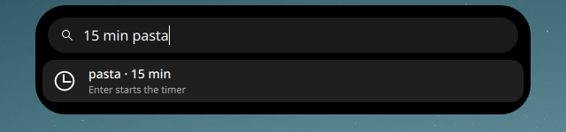
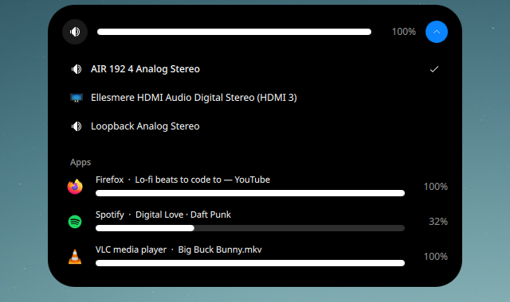
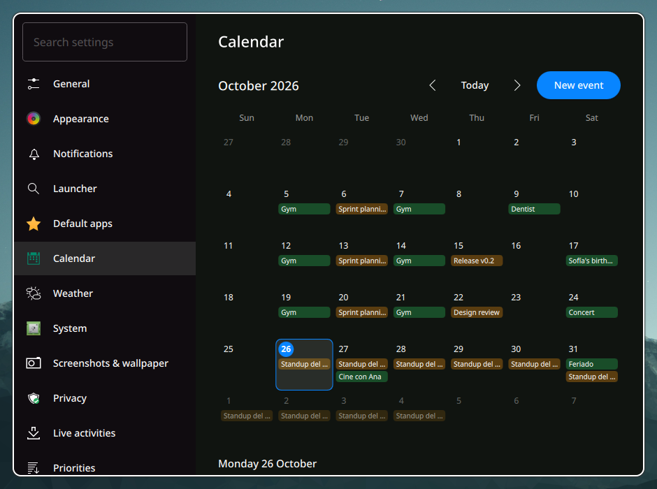
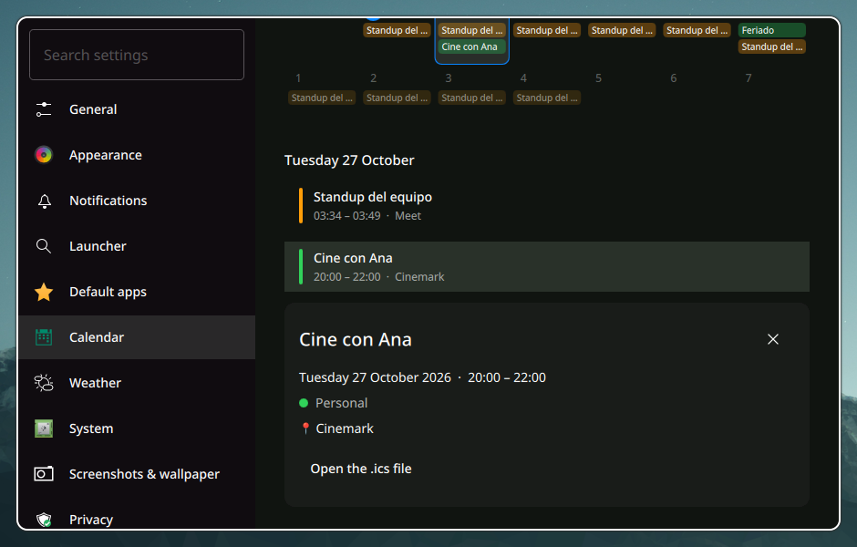
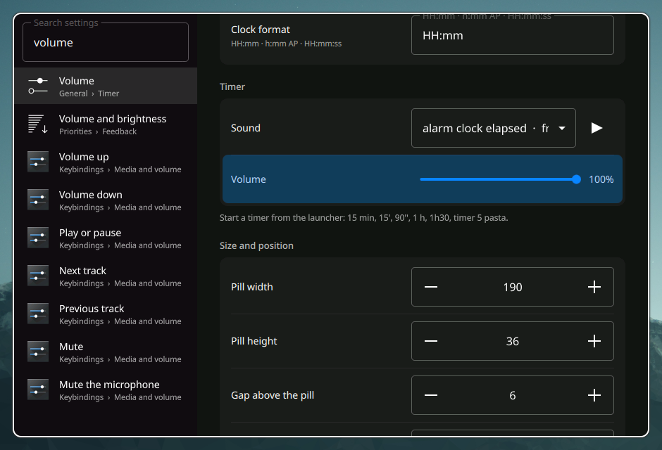
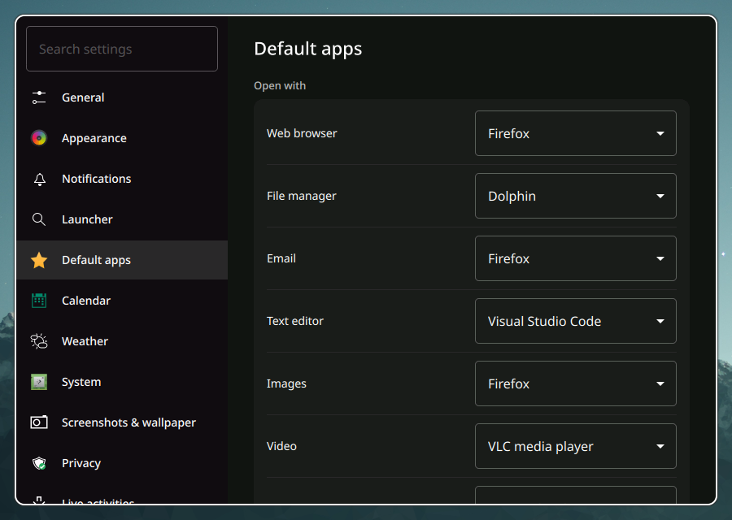

<div align="center">


# island-shell

**A Dynamic Island for Hyprland.** Notifications, media, a launcher, timers,
your calendar and quick settings live in one pill at the top of the screen,
and it never moves your windows.

[](LICENSE)


[Features](#features) ·
[Tour](#a-tour) ·
[Install](#install) ·
[Configure](#configuration) ·
[Write activities](docs/activities.md) ·
[Español: notas de diseño](docs/PLAN.md)


</div>

## Why island-shell

Most bars take a strip of the screen and keep it. island-shell takes a pill.
It grows when something needs you (a message, a song change, a timer that
ran out) and shrinks back when you are done.

Expanding and collapsing never moves your windows. Each monitor gets one
overlay layer surface whose size and exclusive zone never change. The pill
animates inside that surface, and the Wayland input region follows it on
every frame, so clicks outside the pill reach the windows below.

It replaces a bar, a notification daemon, a launcher, a power menu and a
volume OSD with one native C++/Qt process. Everything is configured in one
`config.toml` or in a settings window that edits it for you.

## Features

| | |
|---|---|
| **Notifications** | A full notification server with actions, inline reply, do-not-disturb, per-app rules and a history grouped by app. |
| **Launcher** | Apps, open windows, a calculator, shell commands, web search, emoji, timers and new calendar events from one search field. |
| **Timers** | Type `15 min` in the launcher. The pill counts down and rings with the sound you pick. |
| **Quick settings** | Wi-Fi, Bluetooth, night light, do-not-disturb, live activities on or off, volume per device and per app, microphone, brightness, power profile and pending updates. |
| **System tray** | Status icons of Discord, Steam, nm-applet and other apps, with their menus inside the island. |
| **Power modes** | Power saver and performance turn off Hyprland's animations, blur and shadows and the island's animations, and put them back afterwards. |
| **Updates** | Counts pending updates from the repos and the AUR with paru, yay or pacman, and upgrades in your terminal with one click. |
| **Calendar** | Local `.ics` and vdirsyncer calendars in the island and as a month view in the settings window. |
| **Media** | Controls for any MPRIS player, album art, and media keys that follow the player the island shows. |
| **Live Activities** | Progress from scripts, downloads and terminal commands, pushed with `islandctl` or D-Bus. |
| **System** | CPU, GPU, RAM and SSD gauges with temperatures, battery levels, and alerts when something stays hot or runs low. |
| **Weather** | Open-Meteo forecast with no account, and a rain alert that shows once and gets out of the way. |
| **Privacy** | Indicators for microphone, camera and screen sharing, with the apps using them. |
| **Settings window** | Every option with search, the calendar, default apps, timer sounds and keybindings that record themselves. |
| **Your own activities** | Write activities in QML. They reload when you save the file. |

## A tour

- [Notifications](#notifications)
- [Launcher](#launcher)
- [Timers](#timers)
- [Quick settings](#quick-settings)
- [Per-app volume](#per-app-volume)
- [Power modes](#power-modes)
- [Updates](#updates)
- [Dashboard](#dashboard)
- [Calendar](#calendar)
- [Settings window](#settings-window)
- [Media](#media)
- [Live Activities](#live-activities)
- [System tray](#system-tray)
- [Screenshots and wallpaper](#screenshots-and-wallpaper)
- [Priorities, privacy and fullscreen](#priorities-privacy-and-fullscreen)

### Notifications


Notifications grow out of the pill with their actions and an inline reply
field. Critical ones always come first. `[notifications]` rules mute an app,
keep it out of popups or change its urgency, and the history in the expanded
island groups everything by app.

island-shell is the notification server. Only one program can own
`org.freedesktop.Notifications`, so stop swaync, mako, dunst or hyprpanel
first. If another program holds the name, the island shows an error and
leaves that program alone.

### Launcher


`islandctl launcher toggle` opens it (bind it to SUPER+R). Typing searches
apps and open windows, most used first. A query that looks like math, such
as `2*(3+4)` or `sqrt(2)`, shows the result, and a duration starts a
[timer](#timers). Prefixes switch modes:

| Prefix | Does |
|---|---|
| `=` | calculator; Enter copies the result |
| `>` | run a shell command: apps on their own, anything else (yay, htop, scripts) in a terminal; Shift+Enter the other way |
| `?` | search the web in the default browser (`[launcher] search_engine`) |
| `:` | emoji; Enter types it into the focused window (with `wtype` installed) and copies it |
| `+` | new calendar event, in English or Spanish: `+ tomorrow 3pm dentist 1h`, `+ fri 9 meeting`, `+ mañana 15:00 dentista` |

### Timers

<table>
<tr>
<td width="50%"></td>
<td width="50%"></td>
</tr>
</table>

Type a duration in the launcher and press Enter. It understands the way
people write times:

```
15 min   15m   15'   90''   90"   1 hour   1 h   1h30   1h 30m   1.5 h
10 minutos   2 horas   timer 5   temporizador 5   15 min pasta
```

Words after the duration become the timer's label. The soonest timer counts
down in the pill with a progress ring, and the expanded view lists every
timer with +1 min and cancel. When one ends it plays a sound, expands the
island and stays until you dismiss it. Pick the sound from your installed
sound themes and set its volume on the General page of the settings window.

### Quick settings


Right-click the island or run `islandctl quick`. The panel has network,
Bluetooth, night light, do-not-disturb, live activities, the
[system tray](#system-tray), output volume and device, microphone level,
mute and device, brightness (laptops only), power profile and pending
updates.


The arrows on the Wi-Fi and Bluetooth tiles list networks and devices to
connect to. Secured networks ask for the password. Bluetooth devices that
need a PIN are not supported yet.

Battery levels come from UPower. A laptop battery shows next to the clock,
and any battery, including headphones and controllers, raises an alert
below 15%.

> Wi-Fi, Bluetooth and battery support was tested against simulated
> NetworkManager, BlueZ and UPower (`scripts/testing/fake-system.py`), not
> real hardware.

### Per-app volume



The arrow on the volume slider lists your output devices and, below them,
every app playing audio with its own slider and mute. The list follows
PipeWire live. Apps that report an audio library instead of their own name
("WEBRTC VoiceEngine") show the program's name, such as Discord.

### Power modes

The power profile in quick settings (power-profiles-daemon or tuned-ppd)
changes more than the CPU. Each profile can turn off Hyprland's
animations, blur and shadows and the island's own animations, and run your
commands:

| | Power saver | Balanced | Performance |
|---|---|---|---|
| Hyprland animations | off | as configured | as configured |
| Hyprland blur | off | as configured | off |
| Hyprland shadows | off | as configured | off |
| Island animations | off | as configured | as configured |

Change them on the Power modes page of the settings window
(`[power_modes.<profile>]`). The island changes Hyprland's options at
runtime and puts your values back when you leave the profile, when
Hyprland reloads its config and when the island quits; your config files
never change.

### Updates

The button at the bottom of quick settings shows how many updates are
waiting. It runs `checkupdates` for the repos plus `-Qua` for the AUR, every
`[updates] interval` minutes and again after any upgrade, from the island or
anywhere else. Click it and the upgrade opens in your terminal through
`island-run`, so the island shows how it goes while you answer pacman.

Choose paru, yay or pacman on the System page of the settings window
(`[updates] manager`), or set your own `command`.

### Dashboard


Clicking the pill opens the dashboard: clock, weather, workspaces, the
month, upcoming events, what is playing and system gauges, even while music
plays. Clicking an event opens it in the [settings window](#calendar).
Alerts, live activities and `islandctl expand media` open their own view.

The rain alert expands the island once when rain becomes likely within two
hours, stays in the pill for a minute and leaves. The forecast stays in the
dashboard.

### Calendar



The Calendar page of the settings window (`islandctl settings calendar`)
shows any month with its events. Click a day for its events and an event
for its details: time, calendar, location, description and its `.ics` file.
Double-click a day, or press New event, to add one there.




The island reads local calendars (vdir collections or folders of `.ics`
files) and never talks to calendar servers itself. Without any, events you
add go to a local calendar in `~/.local/share/calendars/local`. To show
Google, iCloud, Nextcloud or any CalDAV calendar, sync it with
[vdirsyncer](https://vdirsyncer.pimutils.org/):

```ini
# ~/.config/vdirsyncer/config
[general]
status_path = "~/.local/share/vdirsyncer/status/"

[pair personal]
a = "personal_remote"
b = "personal_local"
collections = ["from a"]

[storage personal_remote]
type = "caldav"
url = "https://caldav.example.com/"
username = "me"
password.fetch = ["command", "secret-tool", "lookup", "caldav", "me"]

[storage personal_local]
type = "filesystem"
path = "~/.calendars/"
fileext = ".ics"
```

Then run `vdirsyncer discover && vdirsyncer sync` (and add a timer for
periodic syncs). `~/.calendars` is in the default `[calendar] paths`. For
Google Calendar use vdirsyncer's `google_calendar` storage. New events go
to the local folder, and vdirsyncer uploads them on its next sync.

### Settings window



`islandctl settings` (or the gear in quick settings) opens it. Every
control writes one line of `config.toml` and keeps the rest of the file,
comments included, as it was. The shell reloads the file as soon as it
changes.

Press Ctrl+F to search. Results match option names, hints, sections and
pages, with or without accents. Click one and the window opens its page,
scrolls to the option and highlights it.



The Default apps page sets the browser, file manager, mail client, text
editor, image, video and music players and PDF viewer that `xdg-open` and
most apps use (`~/.config/mimeapps.list`). It offers the apps that declare
those file types and the ones in the matching menu category, so editors
like VS Code show up for text.

### Media


Any MPRIS player gets album art, progress and controls. Media keys control
the player the island shows (not whichever one `playerctl` picks). Volume
keys repeat while held and show the level in the pill. Both work on the
lock screen too.

### Live Activities


Scripts show progress or a status in the island with `islandctl`. Every
command takes the same `--id`:

```bash
islandctl push --id build --title "Building" --icon system-run --progress 0 \
  --action "Cancel=pkill make"
islandctl update --id build --progress 0.5
islandctl update --id build --state success --title "Built"   # or --state error
islandctl end build
```

`--ttl SECONDS` removes it on its own (30 minutes by default, 0 never) and
`islandctl live` lists them. Other programs can use the D-Bus interface
(`org.islandshell.LiveActivities`).

The Live activities tile in quick settings (`[live] enabled`) hides all of
them; they are still accepted, and show again when it is turned back on.

Some show up on their own (`[live]`):

- Browser downloads: a `.part` (Firefox) or `.crdownload` (Chromium) file in
  your downloads folder, with its size and speed, then Open and Show in
  folder.
- Progress apps report for their taskbar icon (the Unity LauncherEntry
  signal): Chromium downloads, some file managers and installers.

`island-dl URL [FILE]` downloads a file with aria2c (or curl) and shows its
progress, a Cancel button and Open when it is done.

Commands from a terminal:

- `island-run CMD [ARGS...]` shows the command while it runs, with a button
  that focuses its terminal, then a check mark or the exit code and how long
  it took.
- For zsh, `source /usr/share/island-shell/island-shell.zsh` in `~/.zshrc`
  does it on its own. Programs in `ISLAND_WATCH` (yay, pacman, make, cargo,
  rsync...) show once they run for 2 s, and any other command that takes
  `ISLAND_NOTIFY_AFTER` seconds (30) shows how it ended. Editors, pagers and
  ssh (`ISLAND_IGNORE`) never show.

### System tray

`islandctl tray`, the Tray tile in quick settings or `keybinds.tray` open
the status icons apps put in a tray (StatusNotifierItem): Discord, Steam,
Telegram, nm-applet, KDE Connect and other Electron, Qt and GTK apps. A
click activates the app, a right click opens its menu inside the island
(submenus, check marks and radio items included), a middle click runs its
secondary action and the wheel scrolls it. A dot marks an app that wants
attention.

The island keeps the list of tray apps (`org.kde.StatusNotifierWatcher`)
unless another program already does, such as waybar; then it reads that
one. Apps that started before the island add themselves again when it
starts.

### Screenshots and wallpaper

<table>
<tr>
<td></td>
<td></td>
</tr>
<tr>
<td align="center">Screenshot result</td>
<td align="center">Wallpaper picker</td>
</tr>
</table>

`islandctl screenshot region|window|output|active` takes the shot with grim and
slurp, copies it and shows it in the island with open, copy, edit and
delete.

`islandctl wallpaper` opens the picker with the images in
`[wallpaper] directory`, and `islandctl wallpaper random` applies one
without opening it. `[wallpaper] backend` chooses what sets the wallpaper:
`awww`, `swww`, `hyprpaper`, `swaybg`, `waypaper`, or `command` to run your
own `apply` command. `backend_args` adds options to the backend's command,
such as `--transition-type grow` for awww. With `"auto"` the island uses
waypaper when it is configured, because `waypaper --restore` brings its
last choice back at login. Otherwise it uses the daemon that is running.

The picker marks the wallpaper on screen. It asks awww, swww or hyprpaper,
or reads swaybg's command line, so it also notices changes made by other
tools. After each change the island runs pywal's `wal` when it is installed
(`pywal = false` turns this off).

### Priorities, privacy and fullscreen

When several activities are active, the one with the highest priority takes
the pill and the next one the bubble beside it. `[priorities]` changes
them, for example to keep live activities above the microphone indicator:

```toml
[priorities]
privacy = 30   # default 60
live = 50
```

Critical notifications and menus always come first. `[privacy]` turns the
microphone, camera and screen sharing indicators on or off one by one.

Over a fullscreen window, such as a game or a video, the island hides the
clock, media and privacy indicators and stops taking input. Notifications
and the OSD still show. `[island] fullscreen = "hide"` keeps only critical
notifications; `"show"` disables this.

## Install

island-shell is at version 0.1. On Arch Linux:

```sh
git clone https://github.com/pyeom/island-shell.git
cd island-shell/packaging/arch
makepkg -si
```

[docs/migration.md](docs/migration.md) covers starting it from Hyprland and
moving notifications, the launcher and keybinds over from your current
setup.

### Building from source

Dependencies (Arch Linux):

```sh
sudo pacman -S --needed cmake ninja qt6-base qt6-declarative qt6-wayland \
    qt6-svg qt6-shadertools qt6-tools layer-shell-qt tomlplusplus libpipewire libical
```

Build and test:

```sh
cmake --preset dev
cmake --build --preset dev
ctest --preset dev
```

Optional: `pipewire` and `wireplumber` (volume), `networkmanager`, `bluez`,
`power-profiles-daemon`, `pacman-contrib` (updates), `grim` and `slurp`
(screenshots), `wl-clipboard`, `wtype`, `vdirsyncer`, `python-pywal`.

## Configuration

- Config: copy [`data/config.toml`](data/config.toml) to
  `~/.config/island-shell/config.toml`, or open the settings window. Changes
  apply on save.
- Activities: see [docs/activities.md](docs/activities.md) and
  [`examples/activities/`](examples/activities/).
- Control it from scripts or Hyprland binds with `islandctl`
  (`islandctl --help`).

### Keybinds

Set them in `[keybinds]` or on the Keybindings page of the settings window,
which can record a combination:

```toml
[keybinds]
launcher = "SUPER + R"
power = "ALT + TAB"
media = "ALT + P"
screenshot_region = "Print"
media_play_pause = "XF86AudioPlay"
volume_up = "XF86AudioRaiseVolume"
```

The island adds these binds to Hyprland while it runs (with `hyprctl eval`
for hyprland.lua, `hyprctl keyword` for hyprland.conf) and adds them again
after Hyprland reloads its config. A bind replaces any other bind on the
same keys, so it can stay in your Hyprland config as a fallback. Actions:
`launcher`, `power`, `quick_settings`, `tray`, `settings`, `expand`,
`collapse`, `media`, `wallpaper`, `wallpaper_random`, `screenshot_region`,
`screenshot_window`, `screenshot_output`, `dnd`, `notifications_clear`,
`reload`, `media_play_pause`, `media_next`, `media_previous`, `volume_up`,
`volume_down`, `volume_mute`, `mic_mute`.

Anything else can be bound in Hyprland to an `islandctl` command:

```lua
hl.bind("SUPER + SHIFT + S", hl.dsp.exec_cmd("islandctl screenshot active"))
```

Volume keys need no change. The OSD follows PipeWire, so it shows whatever
program changed the volume.

### Your own activities

Everything the island shows is an activity, and yours use the same API as
the built-in ones. Drop a `.qml` file in `~/.config/island-shell/activities/`
and it loads, and reloads every time you save it. Start from
[`examples/activities/Pomodoro.qml`](examples/activities/Pomodoro.qml) and
read [docs/activities.md](docs/activities.md).

## Development

`scripts/dev-nested.sh` builds the project and runs it inside a nested
Hyprland window with its own D-Bus session, so it does not conflict with
your current bar or notification daemon. Extra arguments go to
`island-shell`:

```sh
scripts/dev-nested.sh          # hover to peek, click to expand
scripts/dev-nested.sh --demo   # cycle through states automatically
```

Inside the nested session, `SUPER+Return` opens a terminal, `SUPER+R`
restarts the shell and `SUPER+SHIFT+E` exits. `scripts/testing/` has
fixtures, a simulated NetworkManager, BlueZ and UPower, and helpers to
drive and screenshot the nested island.

To test with a throwaway config instead of `~/.config/island-shell`:

```sh
ISLAND_SHELL_CONFIG=/tmp/test/config.toml \
ISLAND_SHELL_ACTIVITIES=/tmp/test/activities \
scripts/dev-nested.sh
```

`scripts/test-pkg.sh` builds and installs the package in a clean Arch
container (docker or podman) from the committed HEAD.

Translations live in `i18n/` (Spanish, plus English plural forms). After
changing user-visible strings, run
`cmake --build --preset dev --target update_translations` and translate the
new entries in `i18n/island-shell_es.ts` with Qt Linguist or a text editor.

## Credits

The screenshots come from the nested session in `scripts/testing/`, with
simulated NetworkManager, BlueZ and UPower and sample calendars and audio
streams. The wallpapers in them are from KDE Plasma, under CC-BY-SA-4.0:
Mountain by Andy Betts, Honeywave by Ken Vermette, Flow by Sandra Smukaste,
and Nuvole, Next and Coast by Krystian Zajdel. The album art is cropped
from Honeywave.

## License

GPL-3.0-or-later. See [LICENSE](LICENSE).
