# island-shell

A Dynamic Island style shell for Hyprland, written in C++23 on Qt6 Quick.

<p align="center">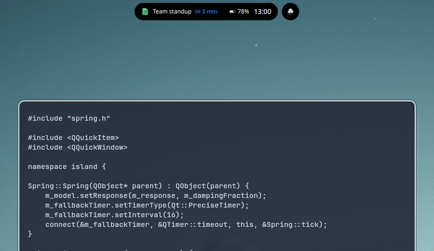</p>

Expanding and collapsing the island never moves your windows. Each monitor
gets one overlay layer surface whose size and exclusive zone never change.
The pill animates inside that surface, and the Wayland input region follows
the pill on every frame, so clicks outside it reach the windows below.

Version 0.1. The design notes and roadmap are in
[docs/PLAN.md](docs/PLAN.md) (in Spanish).

## Features

- Notification server with actions, do-not-disturb and a history grouped
  by app.
- Workspaces as dots on the pill, a clock on every monitor.
- Media controls for any MPRIS player, and a volume and mic OSD.
- Launcher for apps, open windows, a calculator, shell commands, web search,
  emoji and new calendar events.
- Calendar from local `.ics` folders, synced with vdirsyncer.
- Quick settings for Wi-Fi, Bluetooth, night light, audio devices,
  brightness and power profile.
- Microphone, camera and screen sharing indicators.
- CPU, GPU, RAM and SSD gauges with temperatures, and an alert when
  something stays hot.
- Weather from Open-Meteo, with no account, and a rain alert.
- Screenshot results (open, copy, edit, delete) and a wallpaper picker.
- A settings window that edits `config.toml` and keeps its comments.
- Your own activities in QML, reloaded on save, and Live Activities over
  D-Bus from any script.

## Screenshots

<table>
<tr>
<td>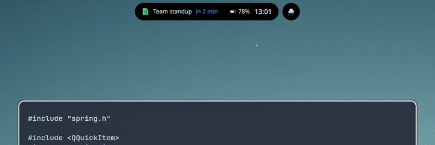</td>
<td>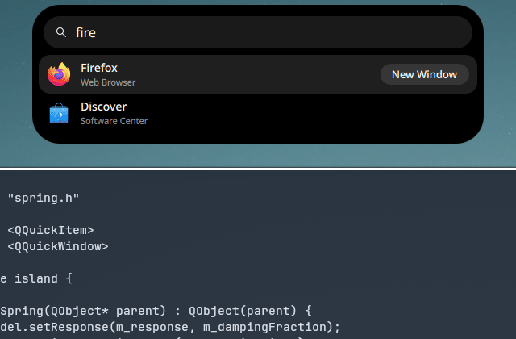</td>
</tr>
<tr>
<td align="center">Notifications with actions and inline reply</td>
<td align="center">Launcher: apps, math, emoji, events, commands</td>
</tr>
<tr>
<td>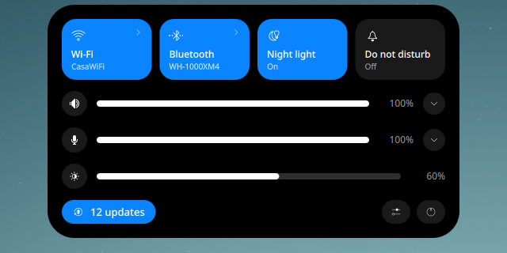</td>
<td>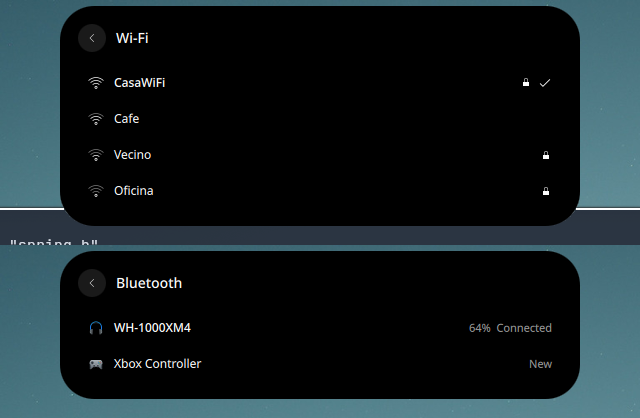</td>
</tr>
<tr>
<td align="center">Quick settings</td>
<td align="center">Wi-Fi networks and Bluetooth devices</td>
</tr>
<tr>
<td></td>
<td>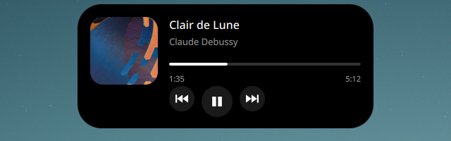</td>
</tr>
<tr>
<td align="center">Live Activity pushed with <code>islandctl push</code></td>
<td align="center">Media controls</td>
</tr>
<tr>
<td>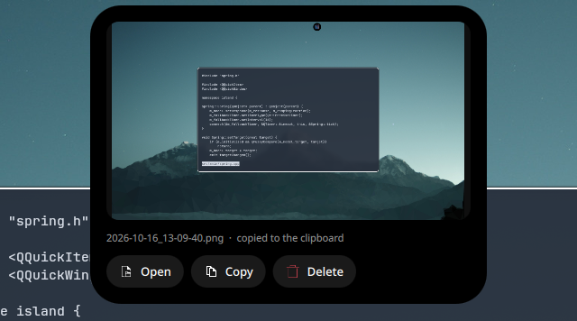</td>
<td>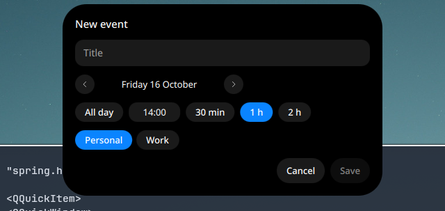</td>
</tr>
<tr>
<td align="center">Screenshot result</td>
<td align="center">New calendar event</td>
</tr>
<tr>
<td>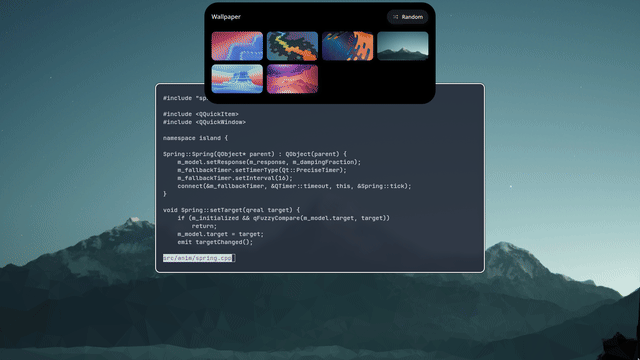</td>
<td>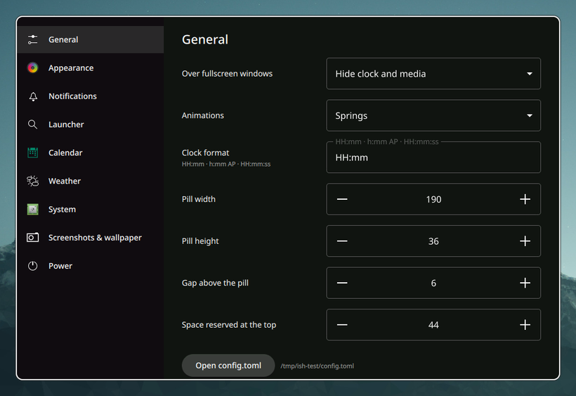</td>
</tr>
<tr>
<td align="center">Wallpaper picker</td>
<td align="center">Settings window</td>
</tr>
</table>

The expanded view: clock, weather, calendar, upcoming events and system
gauges.

<p align="center">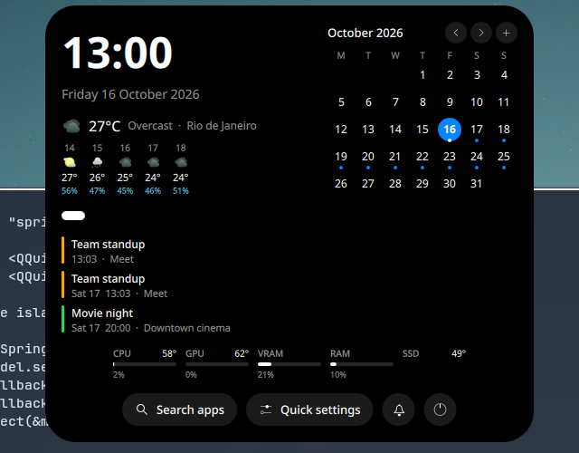</p>

The screenshots come from the nested session in `scripts/testing/`, with
simulated NetworkManager, BlueZ and UPower. The wallpapers in them are
from KDE Plasma, under CC-BY-SA-4.0: Mountain by Andy Betts, Honeywave by
Ken Vermette, Flow by Sandra Smukaste, and Nuvole, Next and Coast by
Krystian Zajdel. The album art is cropped from Honeywave.

## Installing (Arch Linux)

```sh
git clone https://github.com/pyeom/island-shell.git
cd island-shell/packaging/arch
makepkg -si
```

[docs/migration.md](docs/migration.md) covers starting it from Hyprland and
moving notifications, the launcher and keybinds over from your current setup.

## Building

Dependencies (Arch Linux):

```sh
sudo pacman -S --needed cmake ninja qt6-base qt6-declarative qt6-wayland \
    qt6-svg qt6-shadertools qt6-tools layer-shell-qt tomlplusplus libpipewire libical
```

Build and test:

```sh
cmake --preset dev
cmake --build --preset dev
ctest --preset dev
```

## Development

`scripts/dev-nested.sh` builds the project and runs it inside a nested Hyprland
window with its own D-Bus session, so it does not conflict with your current bar
or notification daemon. Extra arguments go to `island-shell`:

```sh
scripts/dev-nested.sh          # hover to peek, click to expand
scripts/dev-nested.sh --demo   # cycle through states automatically
```

Inside the nested session: `SUPER+Return` opens a terminal, `SUPER+R` restarts
the shell, `SUPER+SHIFT+E` exits.

To test with a throwaway config instead of `~/.config/island-shell`:

```sh
ISLAND_SHELL_CONFIG=/tmp/test/config.toml \
ISLAND_SHELL_ACTIVITIES=/tmp/test/activities \
scripts/dev-nested.sh
```

`scripts/test-pkg.sh` builds and installs the package in a clean Arch
container (docker or podman) from the committed HEAD.

Translations live in `i18n/`. After changing user-visible strings, run
`cmake --build --preset dev --target update_translations` and translate the
new entries in `i18n/island-shell_es.ts` with Qt Linguist or a text editor.

## Configuration and activities

- Config: copy [`data/config.toml`](data/config.toml) to
  `~/.config/island-shell/config.toml`. Changes apply on save.
- Activities: see [docs/activities.md](docs/activities.md) and
  [`examples/activities/`](examples/activities/).
- Control from scripts or Hyprland binds with `islandctl` (`islandctl --help`).

## Keybinds

Set them in `[keybinds]` or on the Keybindings page of the settings window,
which can record a combination:

```toml
[keybinds]
launcher = "SUPER + R"
power = "ALT + TAB"
media = "ALT + P"
screenshot_region = "Print"
```

The island adds these binds to Hyprland while it runs (with `hyprctl eval`
for hyprland.lua, `hyprctl keyword` for hyprland.conf) and adds them again
after Hyprland reloads its config. A bind replaces any other bind on the same
keys, so it can stay in your Hyprland config as a fallback. Actions:
`launcher`, `power`, `quick_settings`, `settings`, `expand`, `collapse`,
`media`, `wallpaper`, `wallpaper_random`, `screenshot_region`,
`screenshot_window`, `screenshot_output`, `dnd`, `notifications_clear`,
`reload`.

Anything else can be bound in Hyprland to an `islandctl` command:

```lua
hl.bind("SUPER + SHIFT + S", hl.dsp.exec_cmd("islandctl screenshot active"))
```

Volume keys need no change. The OSD follows PipeWire, so it shows whatever
program changed the volume.

## Notifications

island-shell is a notification server. Only one program can own
`org.freedesktop.Notifications`, so stop swaync, mako, dunst or hyprpanel
first. If another program holds the name, the island shows an error and
leaves that program alone.

## Calendar

The island reads local calendars (vdir collections or folders of `.ics`
files) and never talks to calendar servers itself. Without any, events you
add go to a local calendar in `~/.local/share/calendars/local`. To show
Google, iCloud, Nextcloud or any CalDAV calendar, sync it with
[vdirsyncer](https://vdirsyncer.pimutils.org/):

```ini
# ~/.config/vdirsyncer/config
[general]
status_path = "~/.local/share/vdirsyncer/status/"

[pair personal]
a = "personal_remote"
b = "personal_local"
collections = ["from a"]

[storage personal_remote]
type = "caldav"
url = "https://caldav.example.com/"
username = "me"
password.fetch = ["command", "secret-tool", "lookup", "caldav", "me"]

[storage personal_local]
type = "filesystem"
path = "~/.calendars/"
fileext = ".ics"
```

Then `vdirsyncer discover && vdirsyncer sync` (and a timer for periodic
syncs). `~/.calendars` is in the default `[calendar] paths`. For Google
Calendar use vdirsyncer's `google_calendar` storage.

New events, from the launcher's `+` prefix or the `+` button on the
expanded calendar, go to the local folder. vdirsyncer uploads them on its
next sync.

## Launcher

`islandctl launcher toggle` opens it (bind it to SUPER+R). Typing searches
apps and open windows. A query that looks like math, such as `2*(3+4)` or
`sqrt(2)`, shows the result. Prefixes switch modes:

| Prefix | Does |
|---|---|
| `=` | calculator; Enter copies the result |
| `>` | run a shell command: apps on their own, anything else (yay, htop, scripts) in a terminal; Shift+Enter the other way |
| `?` | search the web in the default browser (`[launcher] search_engine`) |
| `:` | emoji; Enter types it into the focused window (with `wtype` installed) and copies it |
| `+` | new calendar event, in English or Spanish: `+ tomorrow 3pm dentist 1h`, `+ fri 9 meeting`, `+ mañana 15:00 dentista` |

## Quick settings

Right-click the island or run `islandctl quick`. The panel has network,
Bluetooth, night light, do-not-disturb, output volume and device, microphone
level, mute and device, brightness (laptops only) and power profile.

The arrows on the Wi-Fi and Bluetooth tiles list networks and devices to
connect to. Secured networks ask for the password. Bluetooth devices that
need a PIN are not supported yet.

Battery levels come from UPower. A laptop battery shows next to the clock,
and any battery, including headphones and controllers, raises an alert below
15%.

> Wi-Fi, Bluetooth and battery support was tested against simulated
> NetworkManager, BlueZ and UPower (`scripts/testing/fake-system.py`), not
> real hardware.

## Wallpaper

`islandctl wallpaper` opens the picker with the images in
`[wallpaper] directory`, and `islandctl wallpaper random` applies one
without opening it. `[wallpaper] backend` chooses what sets the wallpaper:
`awww`, `swww`, `hyprpaper`, `swaybg`, `waypaper`, or `command` to run your
own `apply` command. `backend_args` adds options to the backend's command,
such as `--transition-type grow` for awww. With `"auto"` the island uses
waypaper when it is configured, because `waypaper --restore` brings its last
choice back at login. Otherwise it uses the daemon that is running.

The picker marks the wallpaper on screen. It asks awww, swww or hyprpaper,
or reads swaybg's command line, so it also notices changes made by other
tools. After each change the island runs pywal's `wal` when it is installed
(`pywal = false` turns this off).

## Live Activities

Scripts show progress or a status in the island with `islandctl`; every
command takes the same `--id`:

```bash
islandctl push --id build --title "Building" --icon system-run --progress 0 \
  --action "Cancel=pkill make"
islandctl update --id build --progress 0.5
islandctl update --id build --state success --title "Built"   # or --state error
islandctl end build
```

`--ttl SECONDS` removes it on its own (30 minutes by default, 0 never) and
`islandctl live` lists them. Other programs can use the D-Bus interface
(`org.islandshell.LiveActivities`).

Some show up on their own (`[live]`):

- Browser downloads: a `.part` (Firefox) or `.crdownload` (Chromium) file in
  your downloads folder, with its size and speed, then Open and Show in
  folder.
- Progress apps report for their taskbar icon (the Unity LauncherEntry
  signal): Chromium downloads, some file managers and installers.

`island-dl URL [FILE]` downloads a file with aria2c (or curl) and its
progress, a Cancel button and Open when it is done.

## Priorities and privacy

When several activities are active, the one with the highest priority takes
the pill and the next one the bubble beside it. `[priorities]` changes
them, for example to keep live activities above the microphone indicator:

```toml
[priorities]
privacy = 30   # default 60
live = 50
```

Critical notifications and menus always come first. `[privacy]` turns the
microphone, camera and screen sharing indicators on or off one by one; both
are also in the settings window.

## Fullscreen

Over a fullscreen window, such as a game or a video, the island hides the
clock, media and privacy indicators and stops taking input. Notifications
and the OSD still show. `[island] fullscreen = "hide"` keeps only critical notifications;
`"show"` disables this.

## License

GPL-3.0-or-later. See [LICENSE](LICENSE).
